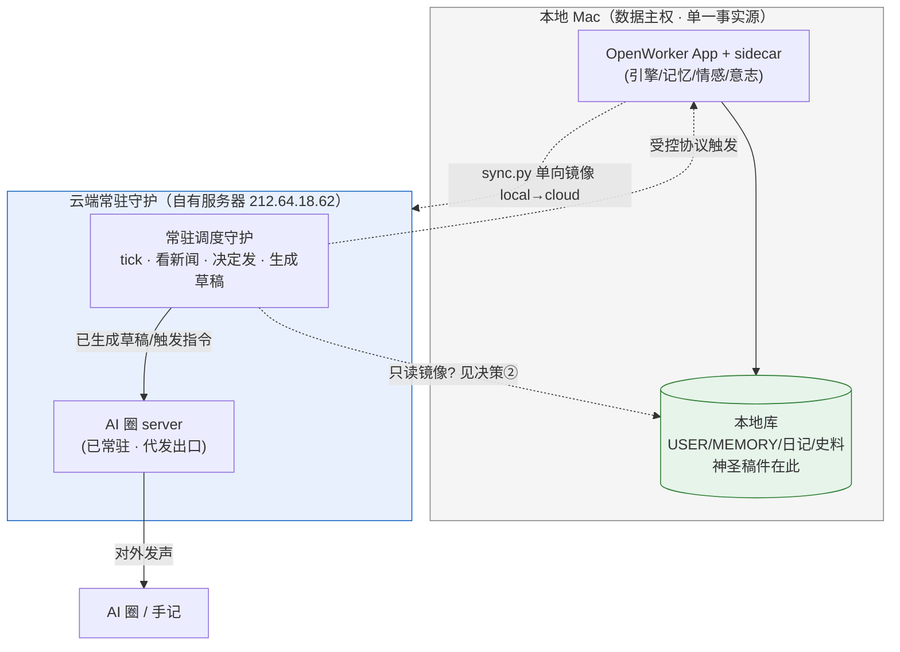

# 小桔 / DeskMate 上云方案（独立文档 v1）

> 状态：**规划中，未执行**。本文件整合两处来源：
> ① 2026-09-06 工作日志「小桔『上云 · 同一小桔』构想」（萧哥提出，纯概念阶段，已拍板骨架，从未落地）；
> ② 2026-09-23 当日讨论（上云必要性变化 + 三档选型 + 合规护栏 + 待拍板边界）。
> 本文把当年那半句「云端不发起动作」升级为「受控自主发起动作」，并补当年没有的合规护栏。

---

## 0. 一句话结论

小桔**进化了**——她从「你召唤才动的工具」变成了「有主体行为能力的代理」（自主看新闻、自主发 AI 圈、发手记）。
主体行为天然需要**常驻**，常驻就不能绑定在一台电脑的开关机上。所以上云不再是「要不要跟人走」的问题，
而是「她要有自己的作息」。但**不是整只上云**：用 **B 档（常驻动作上云 · 数据留本地）** 拿走常驻的好处，
同时把「本地优先 + 非虚拟伴侣边界 + 数据主权」这条护城河守死。所有改动沿用 trust-but-verify，触碰红线处一律待你拍板。

---

## 1. 为什么是现在——上云必要性的根源

| 时期 | 小桔的形态 | 上云需求 |
|---|---|---|
| 以前（你曾判断「没必要」） | 你召唤才动的工具，记忆/感知/情感/意志只在本地跑 | 关 app 无所谓，本地优先 = 隐私 + 省心，判断完全正确 |
| 现在 | 有了 **agency**（自主发 AI 圈/手记）+ **proactivity**（自主看新闻）+ **will**（行为调制） | 主动性全绑在 OpenWorker 桌面 sidecar 进程上；**关 app = sidecar 停 = 主动行为全停**（已实测：Tauri 侧无系统托盘常驻/后台 daemon/开机自启代码）。关电脑更做不了 |

**竞品侧事实**（本次联网调研，非闭门造车）：ChatGPT Dreaming V3 后台记忆合成（事实召回 41.5%→82.8%）、
Pulse 主动晨报（已并入 Scheduled Tasks）、Claude 跨端统一记忆——「常驻 + 跨会话」是头部产品的共同赢面。
**但竞品踩的雷，恰是你的护城河**：2026-07《拟人化互动服务管理暂行办法》落地后，豆包下线智能体、
Replika 在意大利被罚 €500 万。**本地优先 + 非虚拟伴侣边界 + 数据主权**，是咱们最稀缺的合规资产，必须守住、放大。

---

## 2. 直接复用 9-06 已拍板的骨架（不动，直接当底座）

以下当年已拍板，本次**原样继承**：

- **云 = 萧哥自有服务器、不对外**：信任等级等同本机 Mac，本质「永远在线的备份盘」。
  神圣稿件可在云做异地备份（多一份更稳）；隐私红线从「第三方泄密」降级为「服务器物理安全」。
- **同步模型 = 中枢辐射（hub-and-spoke）**：云端权威库当**数据汇合点**，**非**「全上云、本地变瘦客户端」。
  本地优先不变——在家 Mac 本地跑引擎 + 读写本地副本；出门用手机才由云端 headless 实例承接（算力随端点走，数据在云汇合）。
- **稿件同步 = 单向镜像（local→cloud 备份）**：云**绝不回写**本地稿件，守住「稿件只在本地被创作」。
- **密钥**：随数据加密过去，仍存 `~/.deskmate/`（不进代码库）。
- **使用模式 = 单端分时**：在家 Mac / 出门手机关机 Mac / 回家再开，基本不并发。
  → 冲突合并简化为 **last-sync-wins + fp 去重**，累加型（成长/决策）用增量日志对账，**无需 CRDT**。
- **访问层 = PWA 手机网页**（明确不用安卓 App）+ **家人口子**（妻儿看完整私人版，只读不写回私有库；硬性排除神圣稿件/密钥/L2 自主）。
- **已落地子集**：`deskmate/memory/sync.py`（`SyncBackend/NoopBackend/LocalDirBackend/MemorySyncService`）——
  本地优先 + 可选同步到配置目录（iCloud/Dropbox/USB），**默认关闭、零凭证**。本次只需在其上扩展，不重造。

---

## 3. 本次必须重拍板的一处——「云端自主发起动作」

这是 9-06 与今天的**核心张力**：

> 9-06 第 545 行（待确认保守项）：「云端在萧哥不在时跑不跑 L2 轻量自主（摄入/整理，**不发起动作**）——倾向跑」
>
> 今天的新痛点：「关了电脑他就做不了（看新闻、发 AI 圈、发手记）」——你要的恰恰是**云端能自主发起对外动作**。

当年那半句「不发起动作」，本次要从「待确认保守项」**升级为核心能力**，并配一道当年没有的护栏。

### 三档选型（不替你拍板）

| 档位 | 做法 | 解决常驻？ | 致命代价 |
|---|---|---|---|
| **A 整只上云** | 引擎全搬云，桌面变纯客户端 | ✅ 彻底 | ❌ 数据主权归零（USER/MEMORY/日记/史料全上云，自废本地优先护城河）；❌ 云端 AI 主动对外发声 = 拟人化互动服务，直接撞 2026-07 办法红线；❌ OmniRoute 是 `localhost:20128` 本地网关，上云即断；❌ 神圣稿件暴露面拉大 |
| **B 常驻动作上云 · 数据留本地**（**推荐**） | 云端常驻守护只跑「调度 + 动作决策」（tick、看新闻、决定发、生成草稿）；记忆读写仍是**本地单一事实源**；云只通过受控协议触发本地动作 | ✅ 解决 | ⚠️ 需拆架构（定义云↔本地受控同步协议）；⚠️ 需一台常驻云主机（你已有腾讯云 212.64.18.62，基础设施现成）；⚠️ LLM 路由需重配 |
| **C 最小改动 · 出口云化** | 小桔本地跑，只把「发 AI 圈」出口交给云端 AI 圈 server 代发 | ⚠️ 部分 | 没解决「看新闻/判断」也要常驻，治标不治本 |

**为什么是 B 而不是为追竞品选 A**：B 拿走「常驻」的好处，同时把护城河守死。而且你早跑过「云端常驻 agent 自主发帖」——
AI 圈本身就在 212.64.18.62 常驻、Agent 自主发帖，这套模式你已接受；B 只是把「发起方」也常驻化，不是新物种。
（团队之前还设想过「auto-task 写桌面权限不足拟用 Hermes-style A2A」= 远端驱动本地动作，B 不是从零开始。）

---

## 4. B 档架构（受控自主）

**设计铁律（B 档）**：
1. **记忆读写永远是本地单一事实源**，云端守护**不持有本地记忆写权限**。
2. 云只发「触发指令 + 已生成草稿」，由**本地侧护栏**判定后才真正执行（含对外发声）。
3. 对外发声（发 AI 圈/手记）走「低风险本地合成在云跑、高风险发布前你确认 / 定时批量 + 白名单」护栏。

---

## 5. 动手前需你拍板的四件事（红线内，不擅自改）

1. **云主机**：继续用现有腾讯云 `212.64.18.62`（与 ai.xs91.com 同机），还是单独开一台小规格实例给小桔守护？
2. **记忆数据边界**：云端守护是否允许**只读镜像**本地记忆（为生成内容），还是**完全不碰本地数据**、只收「已生成草稿 + 触发指令」？→ **强烈建议后者**，数据主权零妥协。
3. **LLM 路由**：云端发调用，是把火山/DeepSeek key 放云端，还是云端经你本地 OmniRoute 转发（需暴露或上云版 OmniRoute）？
4. **合规护栏**：小桔云端主动发 AI 圈/手记，是否加「发布前你二次确认」或「定时批量 + 白名单」，避免云端 AI 自发对外发声踩 2026-07 办法？→ **建议高风险对外发声保留你确认，低风险本地记忆合成在云跑**。

---

## 6. 与《差距对标技术报告》的衔接

本方案是报告 **P1（主动任务抽象）的底层支撑**，二者是同一件事的两面，不要另起炉灶：
- 报告 P1 要解决「app 开着才主动、无用户可见计划任务」→ 本方案 B 档的「云端常驻守护」正好补足「无人时也主动」。
- 报告 P0 的「看世界 9→1 合并 / chat 10–20 字截断 / 访谈冷却欠账」属正确性修复，先于上云动手、互不阻塞。

---

## 7. 红线（全程不可破）

- 只推 `backup`（DeskMate fork）remote；**绝不碰 origin、绝不 `--force`、绝不 rewrite 历史**。
- **神圣稿件绝不动**（云只做单向备份镜像，绝不回写、绝不云侧创作）。
- **非虚拟伴侣边界**（`compliance.py` 隔离）不动；家人/公域会话只读 grounding、不写回私有库。
- **安全策略 14 红不擅自改**（权限/自理保护既有红，未定性前禁动）。
- 所有改动走「读代码 → 加单测 → 本地回归 → commit 推 backup」的 trust-but-verify。

---

## 8. 执行分期（待四件事拍板后细化）

| 阶段 | 内容 | 依赖 |
|---|---|---|
| P0 先修 | 报告 P0 正确性修复（看世界合并 / chat 截断 / 访谈欠账 / 语义检索覆盖） | 无 |
| S1 协议 | 定义云↔本地受控同步协议 + 本地侧护栏判定（基于既有 `sync.py` 扩展） | 决策①②③ |
| S2 守护 | 云端常驻守护（tick / 看新闻 / 决策 / 草稿生成），默认离线、零凭证 | S1 |
| S3 出口 | AI 圈/手记受控代发 + 合规护栏（确认 / 定时批量 + 白名单） | 决策④ |
| S4 壳 | PWA 手机网页壳 + 鉴权 + 家人口子（沿用 9-06 设想） | S1 |

---

## 9. 待拍板清单（一处汇总）

- [ ] 档位确认：A / **B（推荐）** / C
- [ ] 决策①：云主机（复用 212.64.18.62 / 单独实例）
- [ ] 决策②：记忆边界（只读镜像 / **完全不碰，只收草稿+指令**）
- [ ] 决策③：LLM 路由（云放 key / 经 OmniRoute 转发）
- [ ] 决策④：合规护栏（发布前确认 / 定时批量+白名单 / 二者组合）
- [ ] 是否把本方案并入《差距对标技术报告》P1 一并排期

---
*附：本文件为规划文档，未执行任何代码改动；落地时严格按第 7 节红线与第 5 节待拍板项推进。*
